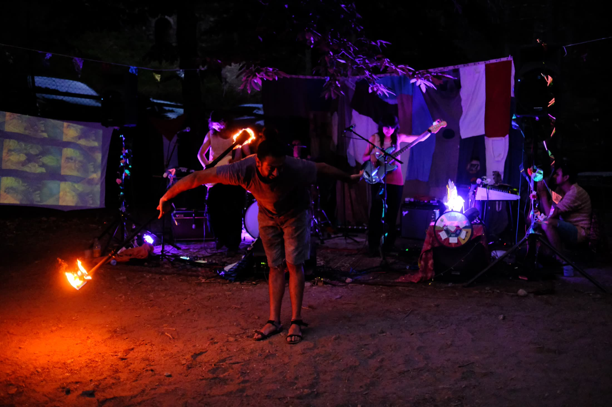
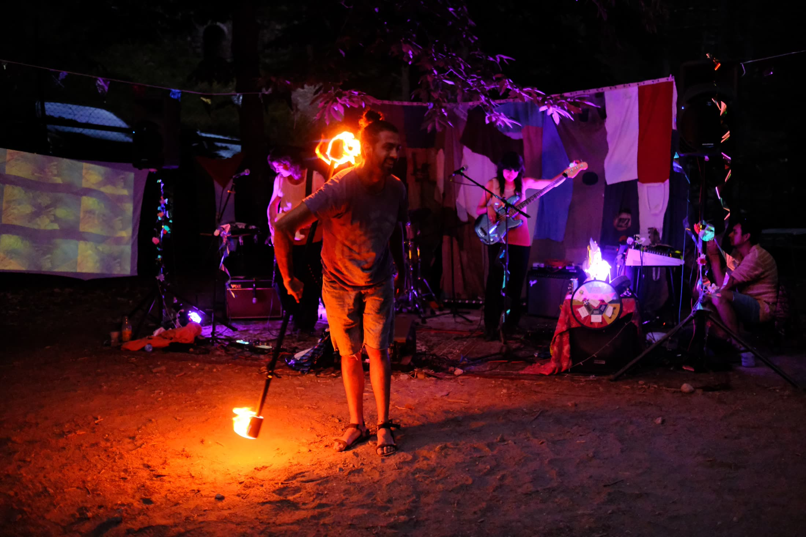
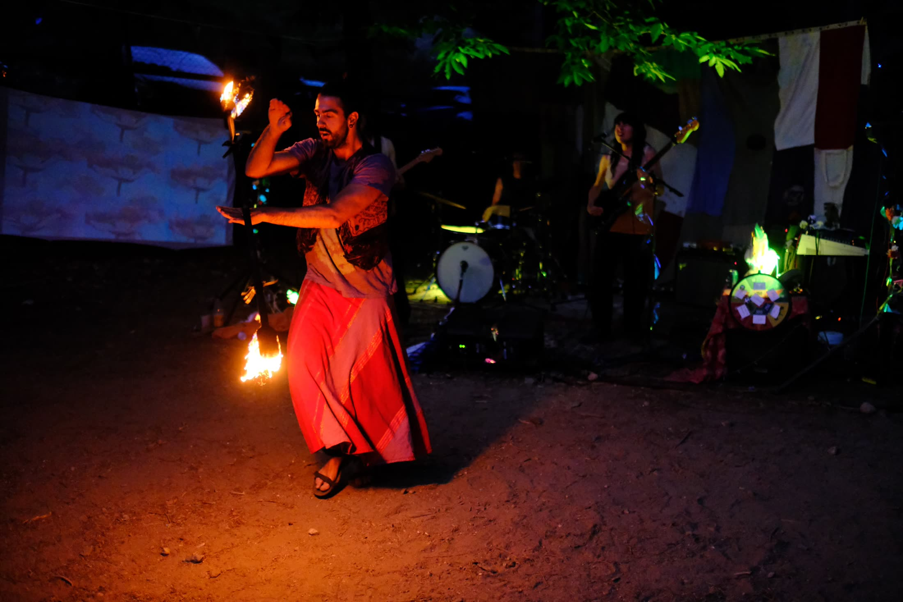
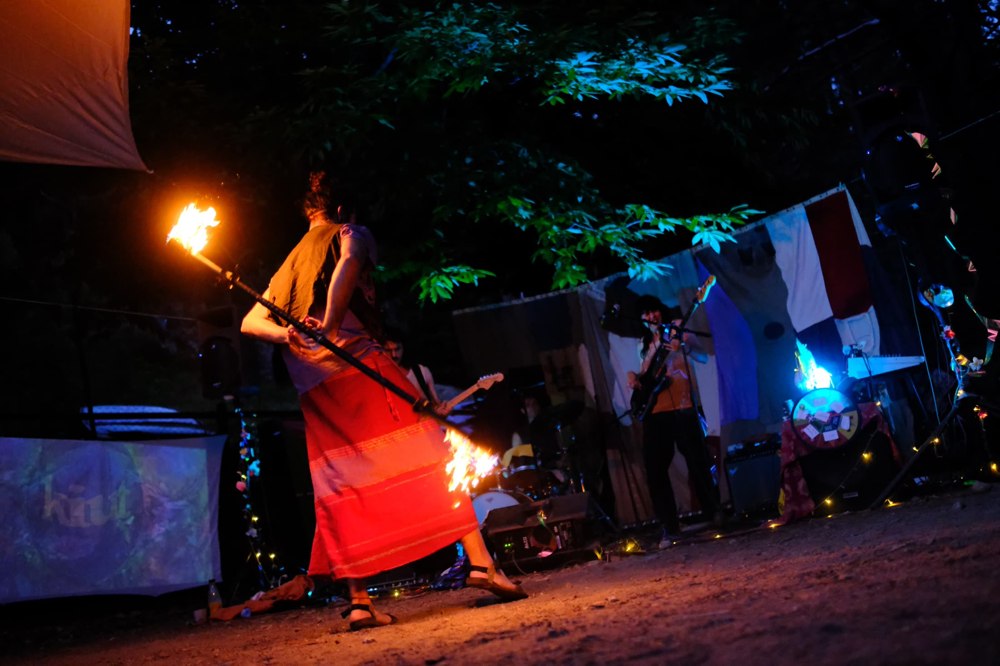
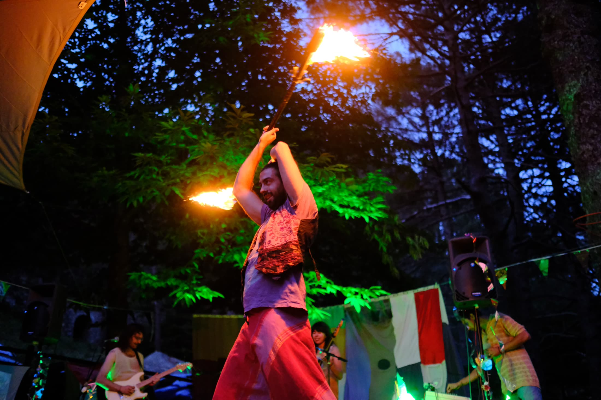
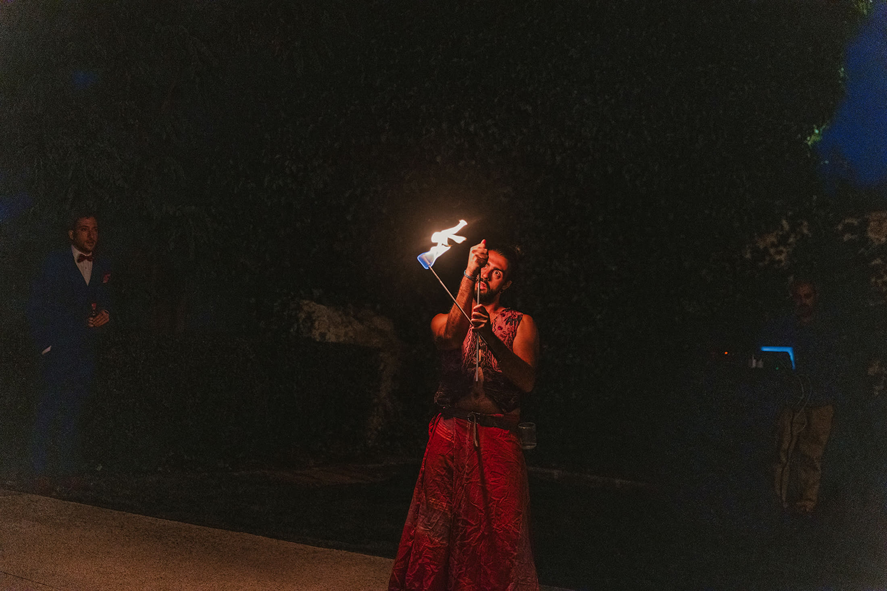
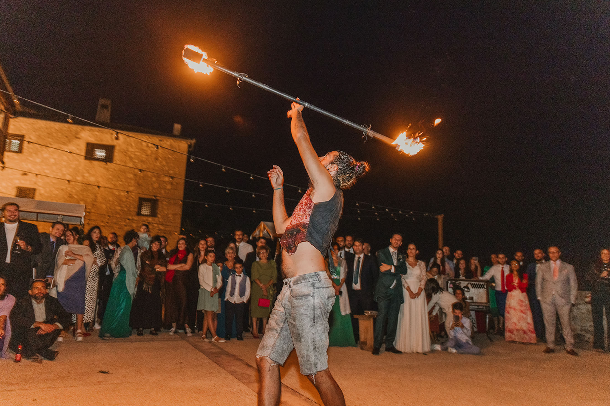
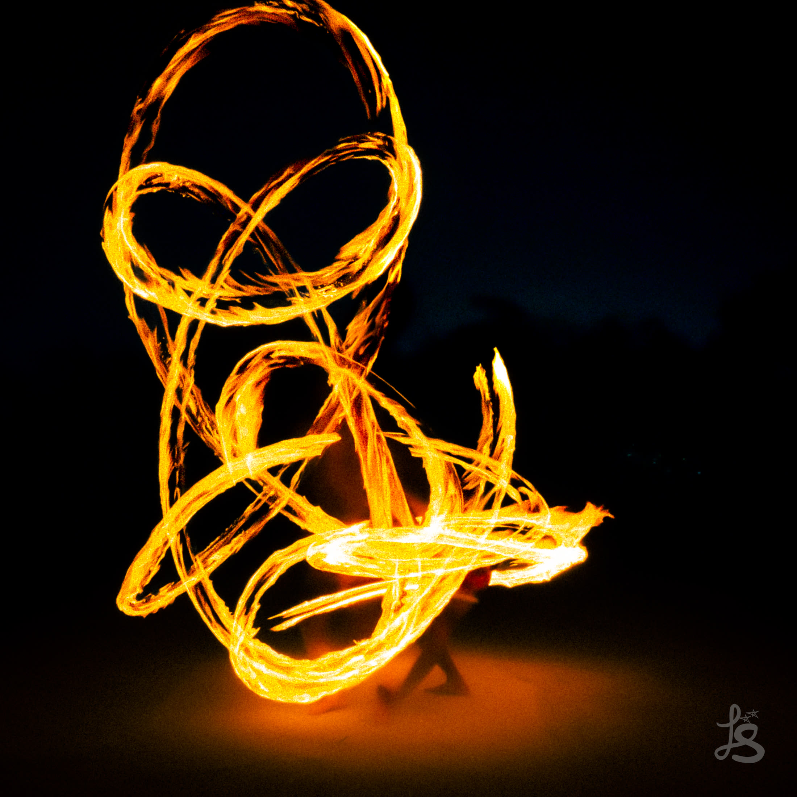

## Descripción
Manipulación de fuego con diferentes disciplinas: 
- Staff (bastón): spinning y contact.
- Antorchas: manipulación, pirofagia y escupido.

## Características técnicas
- Malabares con fuego

## Timeline
- Junio 2025: campamento Aventurarte - acto Maui
- Septiembre 2025: boda de Azucena e Ignacio - acto Three Islands
- Septiembre 2025: boda de Alberto y Marina - acto Three Islands
- Septiembre 2025: boda de Andrea y Rafael - acto Three Islands
- Junio de 2026: concierto de Kiut (T.I.P.I.S festival)
- Julio de 2026: boda de Alicia y Carlos - acto Fuego by Kiut

## Galería

