## Descripción
Una Algorave es una sesión en la que tanto la música como los visuales se generan en el momento programándolo en tiempo real. Los espectadores ven en tiempo real las pantallas de los artistas haciéndoles partícipes de los logros y fracasos. 
En esta sesión comencé con una serie en la que estoy trabajando que explora los límites de la tecnología en nuestra sociedad, la vigilancia y la privacidad. Utilizando técnicas de hacking y combinándolas con la generación de visuales en tiempo real, pone al espectador en un lugar incómodo que le invita a repensar el uso que hace de la tecnología y el papel que ocupa en la sociedad.

## Características técnicas
- Live coding
- Visuales audioreactivos y generativos
- Hacking
- Software: TouchDesigner, herramientas de hacking

## Ficha técnica
- Colectivo: Algorave Madrid
- Organizador: Museo Reina Sofía
- Música: Jeanne-Marie Dalbavie / Djeannette la Loca @Janeyyhy

## Galería
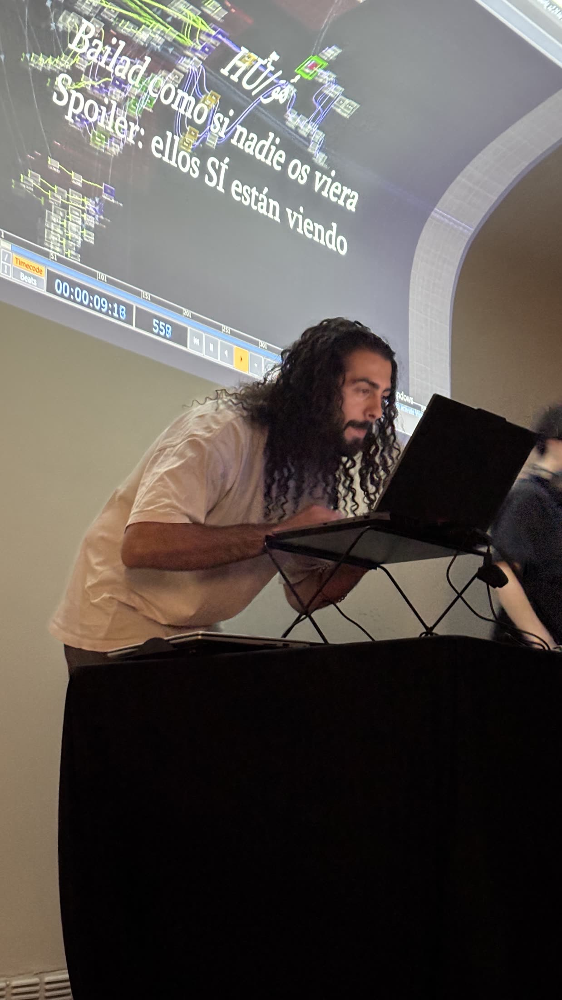
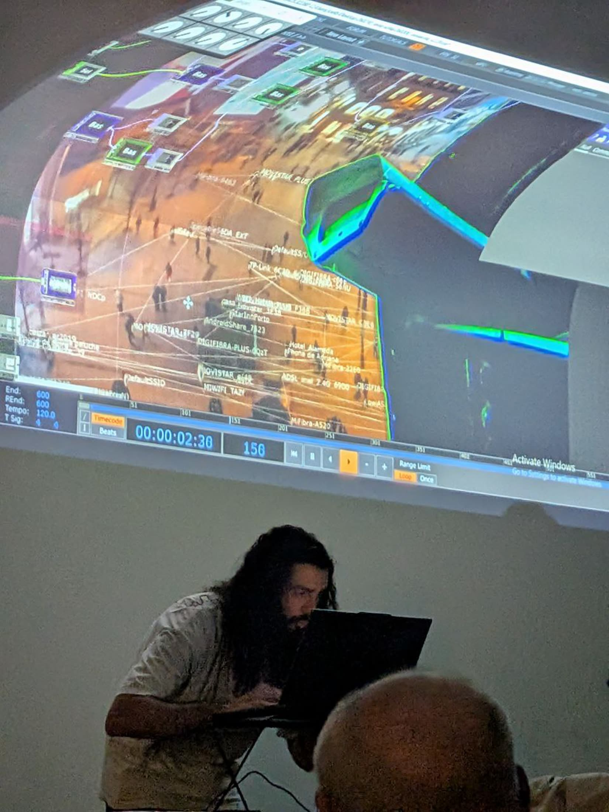
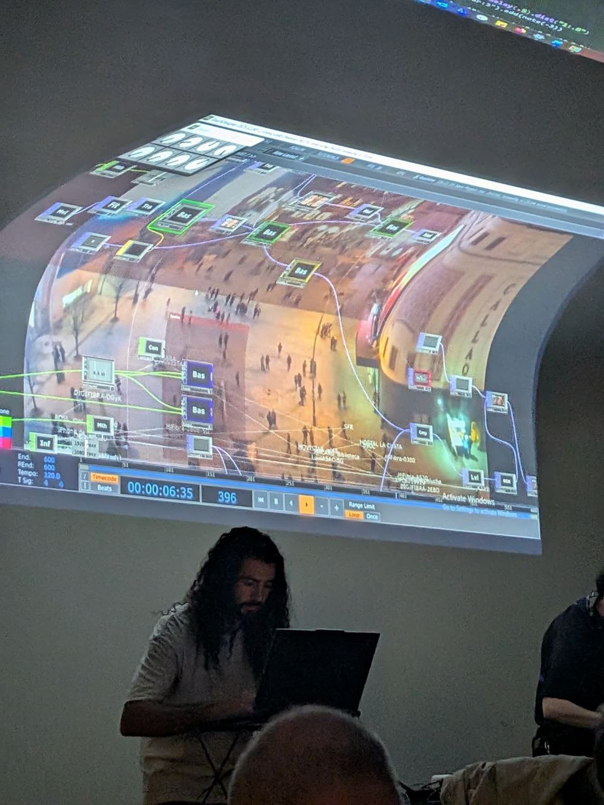
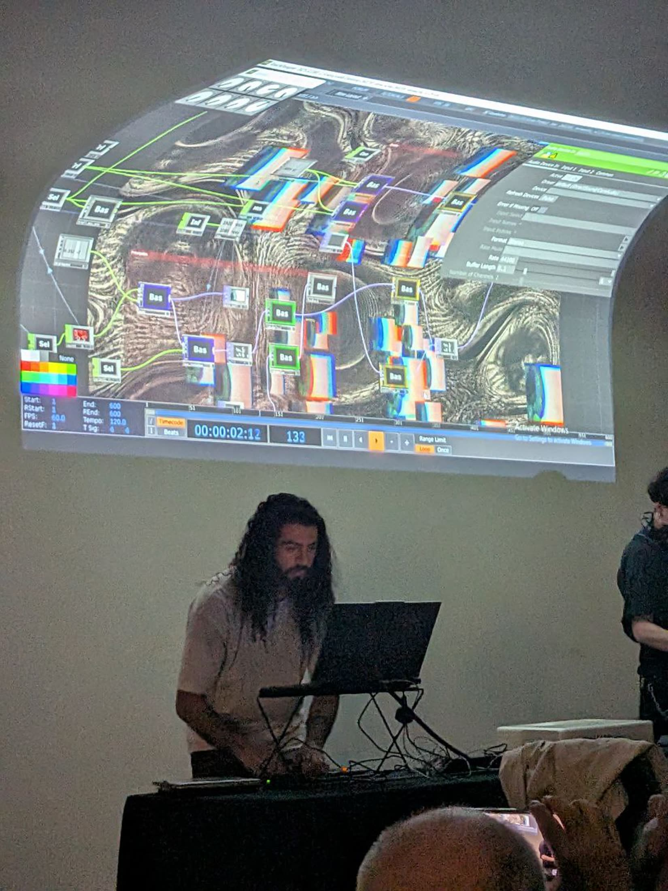
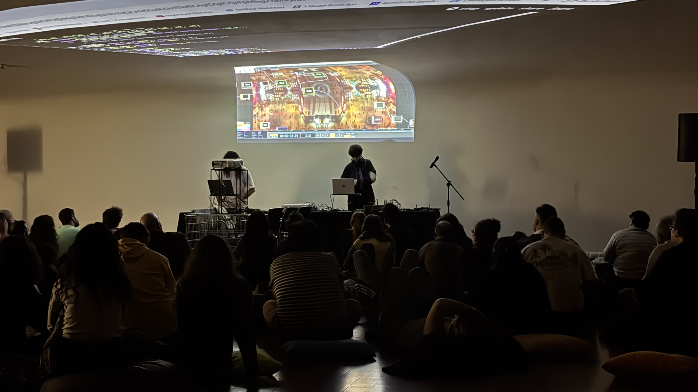
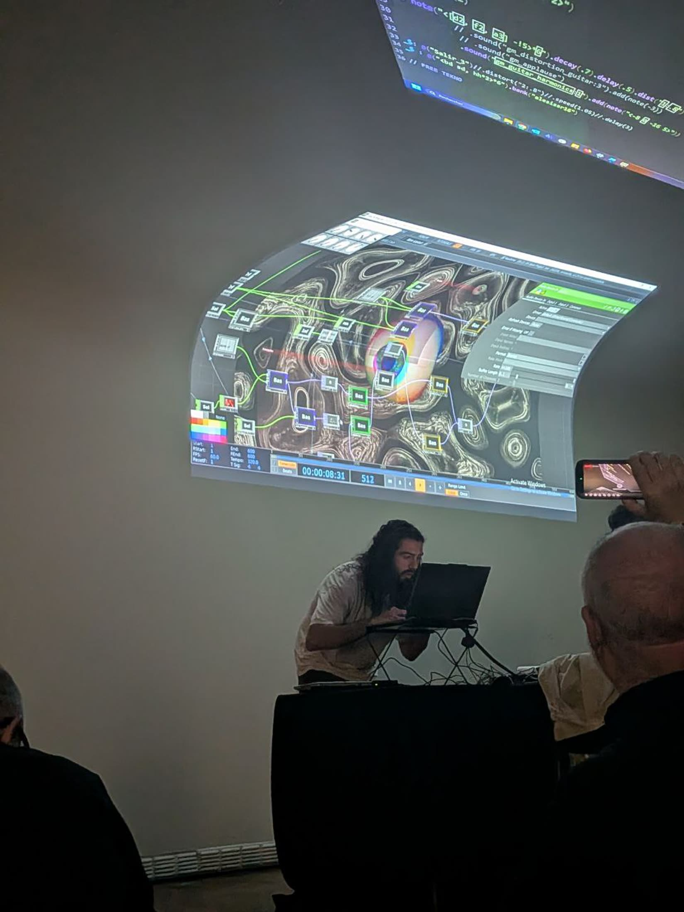
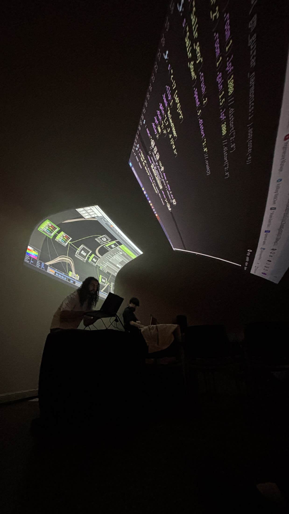
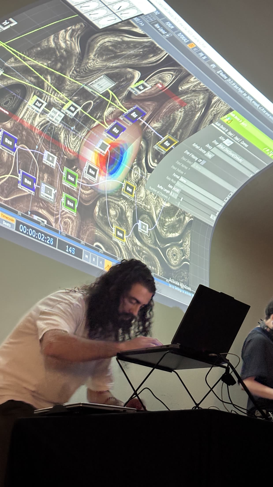
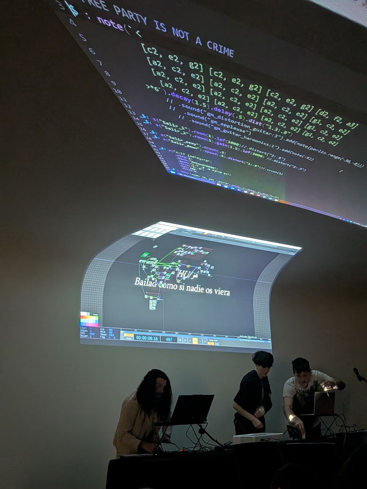
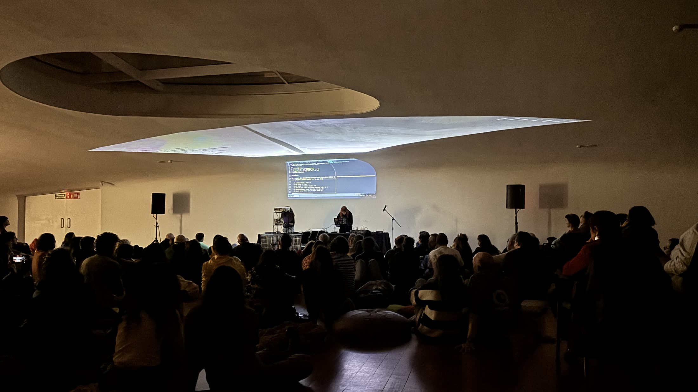
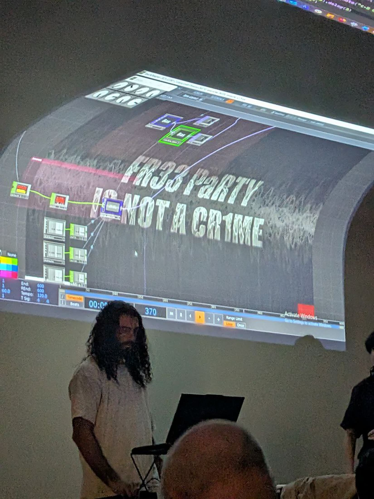

