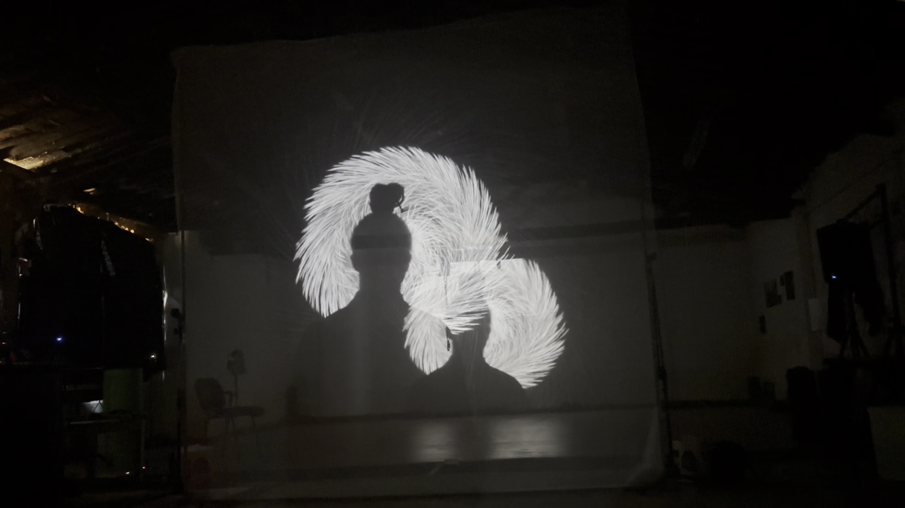
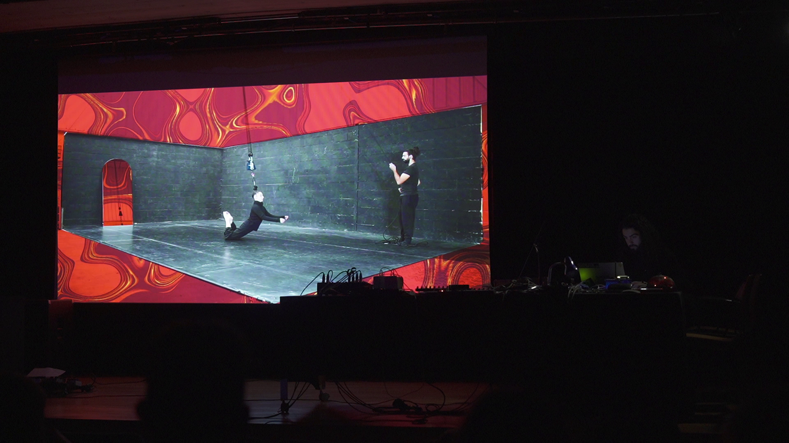
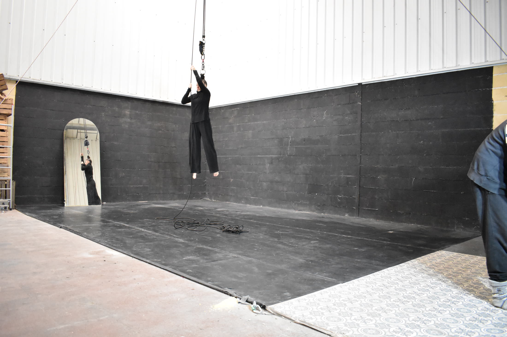
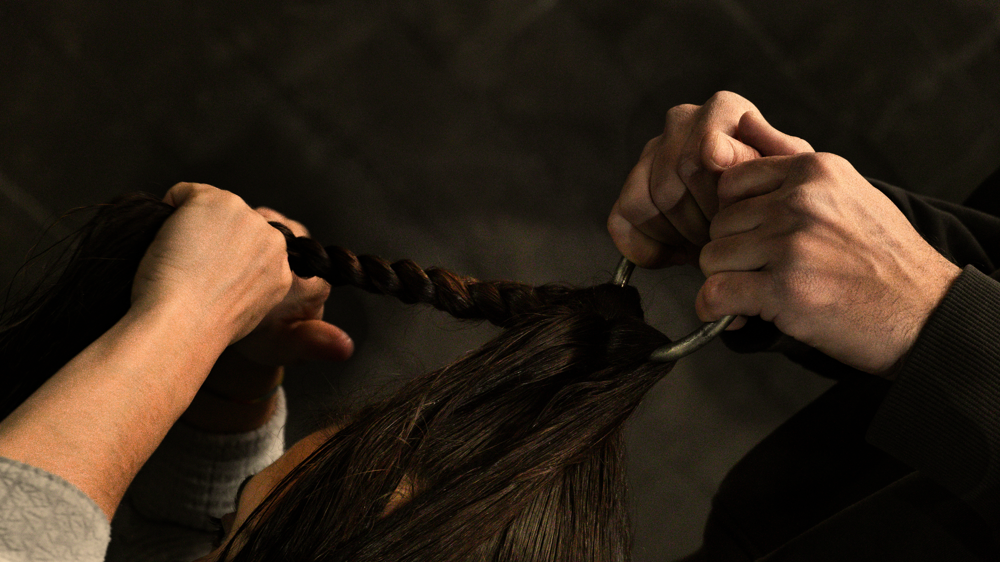
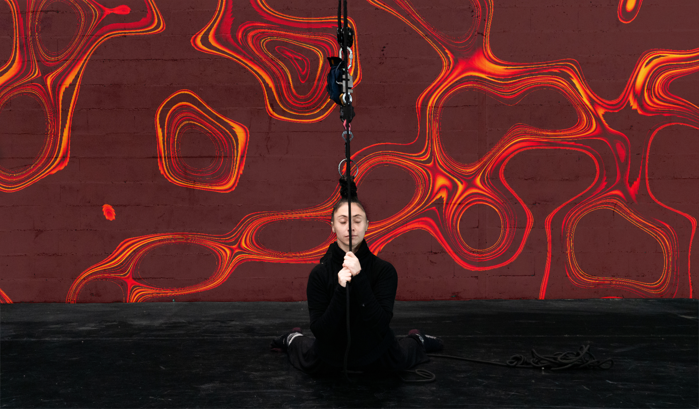
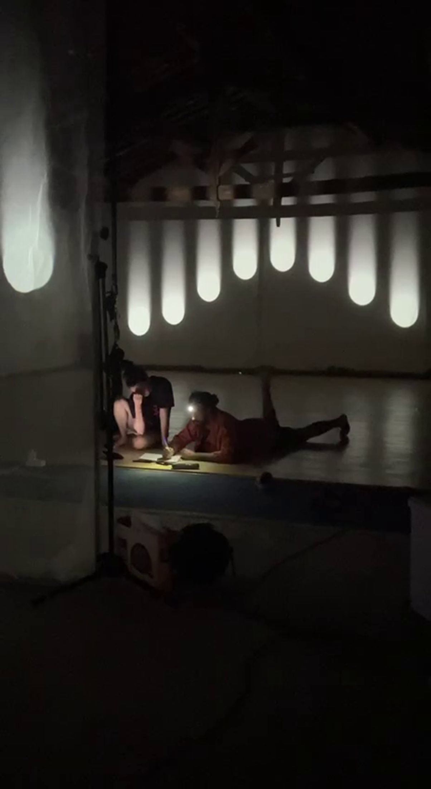
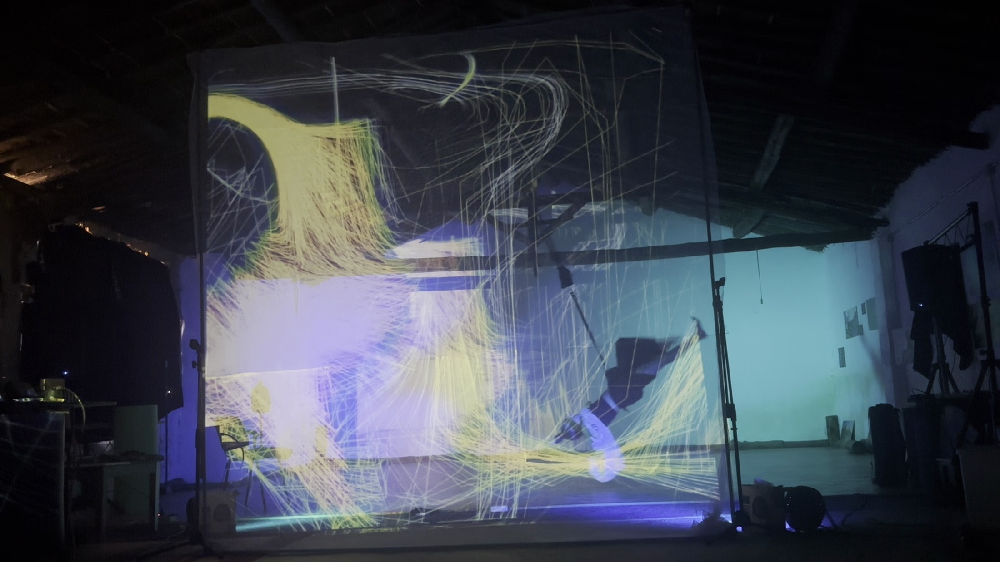
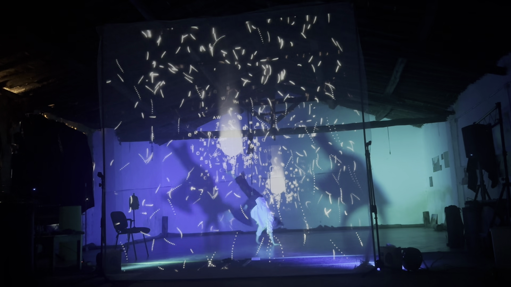
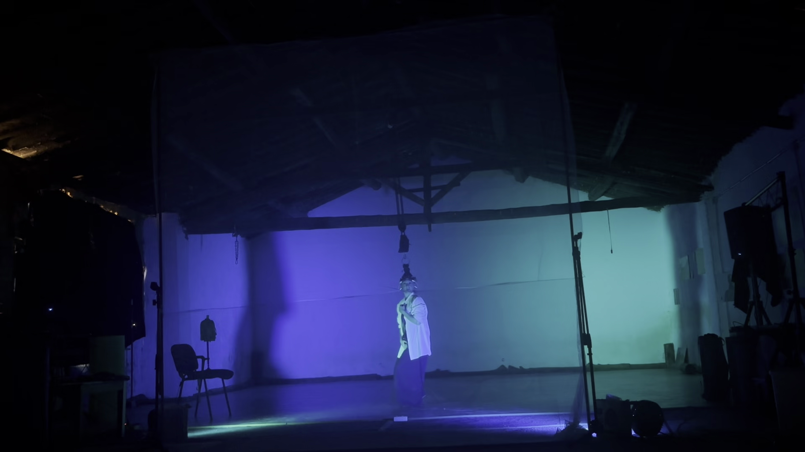

## Descripción
En desarrollo.
ALPHA 1 es una pieza de circo contemporáneo que combinando suspensión capilar aérea, visuales generativos en tiempo real y música electrónica en vivo, busca **hacer visible lo invisible**. Un sensor de carga, un giroscopio/acelerómetro y un casco EEG modificado capturan el movimiento y la actividad de la intérprete y los transmiten de forma inalámbrica a un sistema que traduce esos datos en imagen y sonido, creando un diálogo directo entre cuerpo, tecnología y percepción.

## Características técnicas
- Proyección holográfica
- Interactividad con sensores que modifican en tiempo real visuales y música
- Videomapping
- Circo: suspensión capilar, acrodanza y danza vertical
- Software: Arduino, TouchDesigner, Ableton

## Timeline
- Versión 1: *Ceci n'est pas la fine* - La Casa Encendida (Madrid), diciembre 2025 - muestra en vídeo mixta (pregrabado + visuales reactivos en directo), 8 minutos ([Muestra completa](https://www.youtube.com/watch?v=w8SF_inwRnA))
- Versión 2: Gijón, gala de Circo Bajo el Tejado, enero 2026 - proyección sobre la primera versión con pantalla holográfica, 8 minutos
- Versión 3 (actual): en proceso de creación - visuales y música en directo videoproyectados, 19 minutos hasta ahora

## Ficha técnica
- Idea original, dirección y visuales: Joel Beleña
- Artista de circo: Eva Selvi ([@e.vita.e](https://www.instagram.com/e.vita.e/))
- Composición musical y asistente de dirección: Ernesto Gabari

## Agradecimientos
- Circo Bajo el Tejado
- La Horizontal
- Carampa
- MolinoLab
- La Gata Japonesa

## Galería

