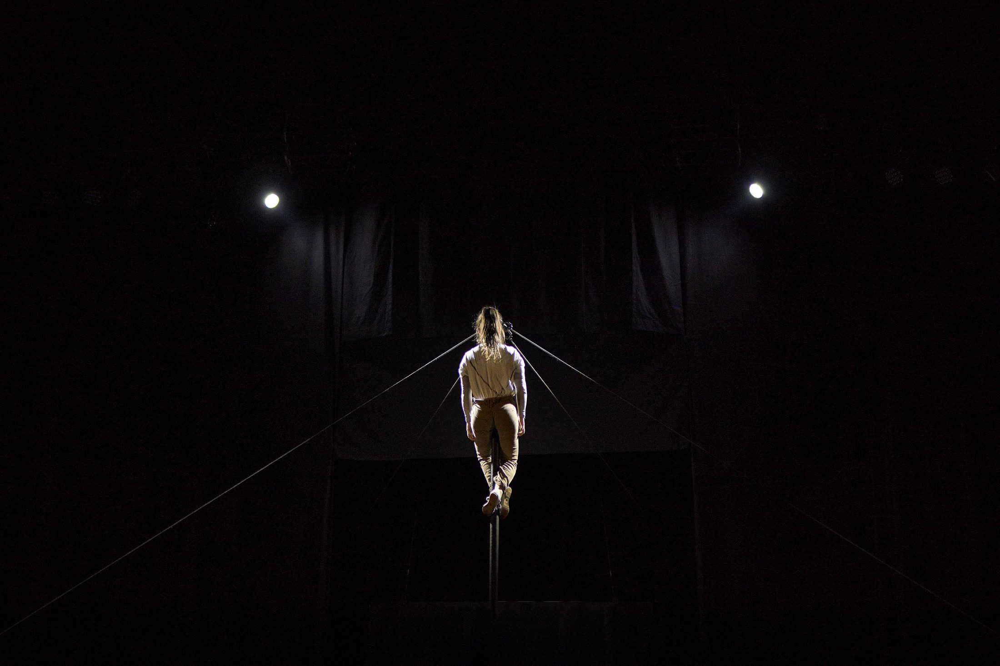
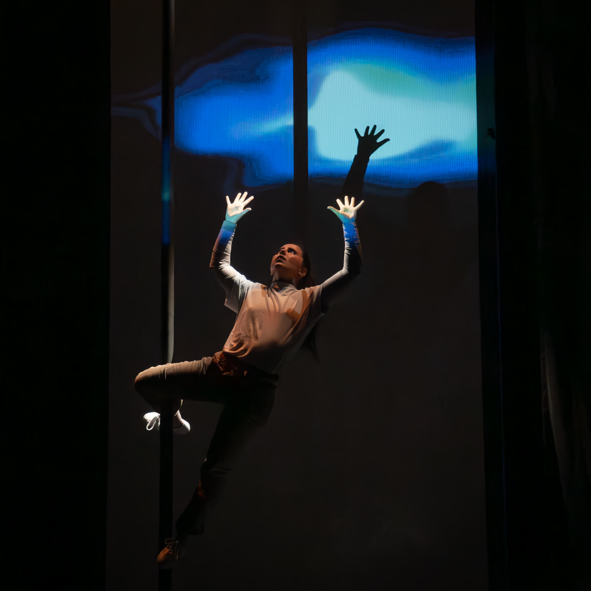
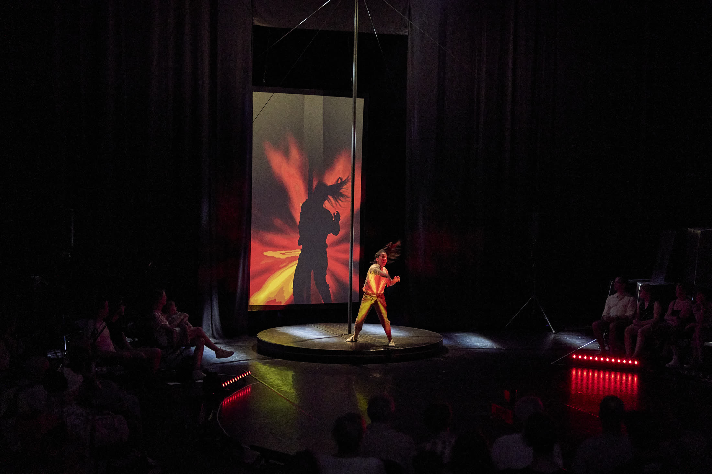
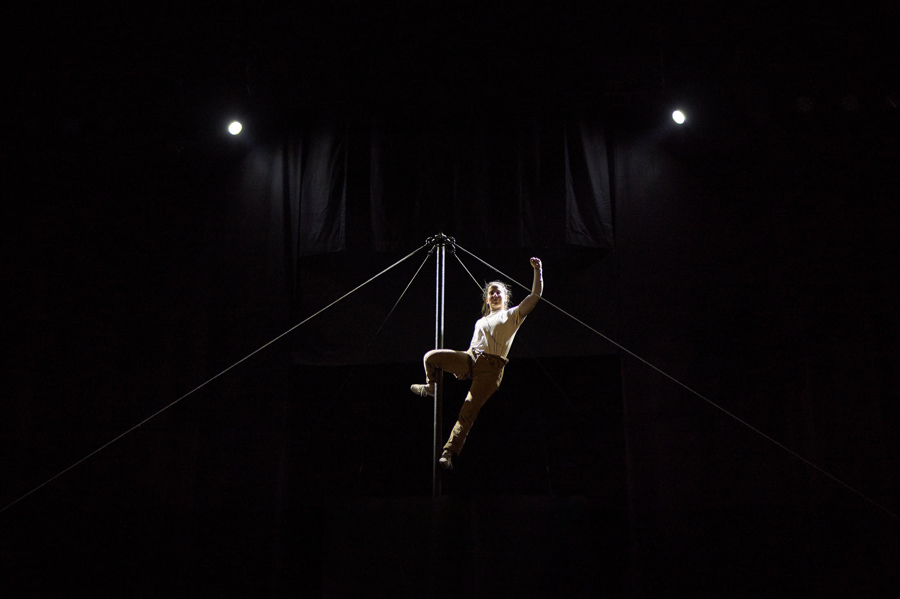
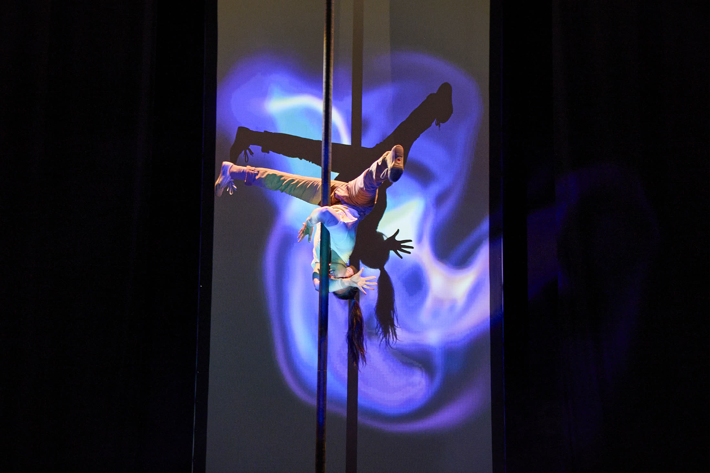
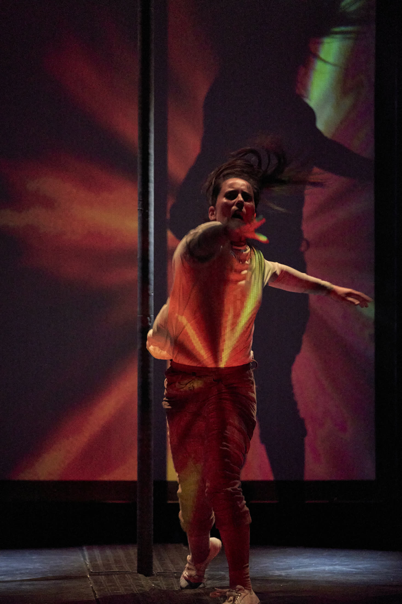

## Descripción
*Borrador a partir del vídeo — revísalo y ajústalo: YouTube no deja extraer la descripción completa sin JavaScript, así que esto está reconstruido solo a partir del título del vídeo ("LUMEN – Chinese Pole & Live Visuals | Leire Froufe | Fontys Circus Graduation Act") y los datos que me diste.*

Actuación única para el acto de graduación de Leire Froufe Vigara en Fontys, que combina mástil chino con proyecciones interactivas en tiempo real. Esta versión fue el origen del proyecto Lumen, germen del posterior *Lumen - Show*.

## Características técnicas
- Body mapping (body tracking + video mapping)
- Visuales generativos
- Shaders
- Circo: mástil chino
- Software: TouchDesigner, MediaPipe

## Timeline
- 20 y 21 de junio de 2025: Acto de graduación - Fontys Academy of Arts (Tilburg - NL)

## Ficha técnica
- Idea original, dirección y cuerpo: Leire Froufe Vigara ([@lenxa.fv](https://www.instagram.com/lenxa.fv/))
- Diseño visual: Joel Beleña
- Composición musical: David Ramírez Mallavibarrena ([@davidavs_](https://www.instagram.com/davidavs_/))
- Vídeo: https://www.youtube.com/watch?v=6Bn1ApshXB8

## Galería

