## Descripción
Una pieza en solitario que combina mástil chino con proyecciones interactivas en tiempo real. Lumen nace de la experiencia personal de Leire Froufe en Palestina, donde fue testigo de las consecuencias de la ocupación y del silencio global que la rodea. En esta pieza, Leire explora el duelo como un proceso colectivo y político.

A través del juego físico y de elementos visuales emerge un lenguaje visual poético y no verbal, en el que la luz se convierte en una compañera activa en escena, proyectada tanto sobre el escenario como sobre su propio cuerpo. Lumen transforma el duelo en fuerza compartida y conecta la sanación personal con la resiliencia política. Una pieza visual y contundente, todavía en desarrollo, que invita a públicos de cualquier procedencia a reflexionar sobre la justicia, la memoria y la resiliencia.

*Pendiente: valorar si añadir aquí un segundo párrafo centrado en el proceso técnico (creación de las luces/visuales) — lo hablamos en el chat.*

## Características técnicas
- Video mapping
- Visuales generativos
- Interacción música + visuales
- Shaders
- Circo: mástil chino
- Software: TouchDesigner, Ableton

## Timeline
- Septiembre 2025: Presentación work in progress - Circo Price (Madrid), gracias a MADPAC
- Noviembre 2025: Primer work in progress de la beca Circustraction - Theater De Landing y Maaspodium Rotterdam (NL)
- Marzo 2026: Work in progress - La Nave del Duende (Cáceres, España)
- Mayo 2026: Último work in progress - Circusstad Festival (NL), gracias a la beca Circustraction
- Julio 2026: muestra work in progress - Nexo Festival (BCN), gracias a la beca UMBRAL

## Ficha técnica
- Idea original, dirección y cuerpo: Leire Froufe Vigara ([@lenxa.fv](https://www.instagram.com/lenxa.fv/))
- Diseño visual: Joel Beleña
- Composición musical: David Ramírez Mallavibarrena ([@davidavs_](https://www.instagram.com/davidavs_/))
- Dramaturgia: Ángela Bueno ([@angelaharrisbueno](https://www.instagram.com/angelaharrisbueno/))

## Galería

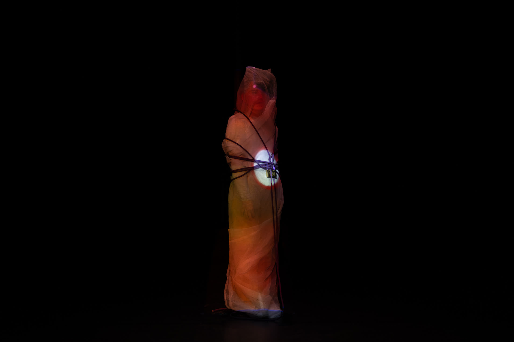
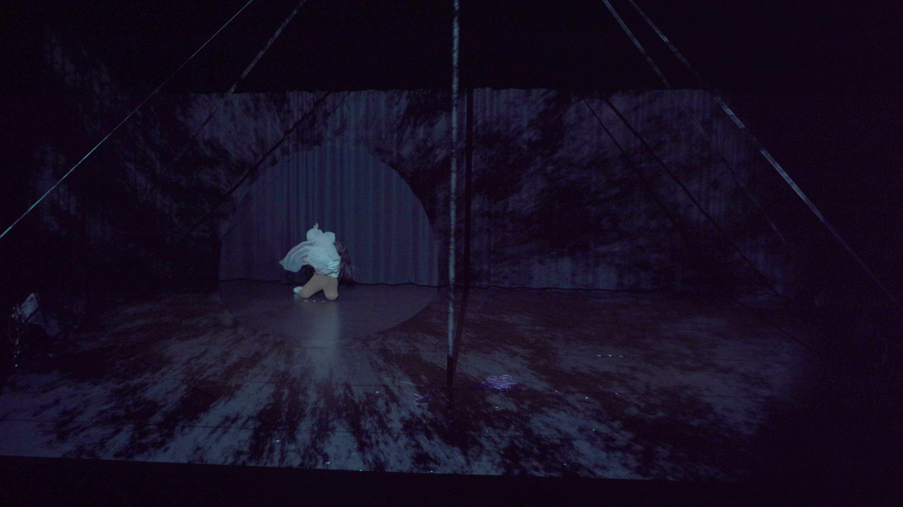
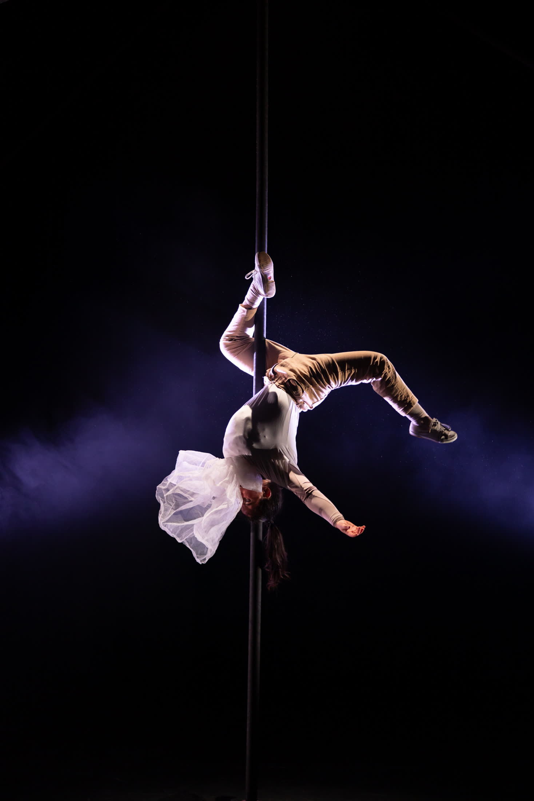
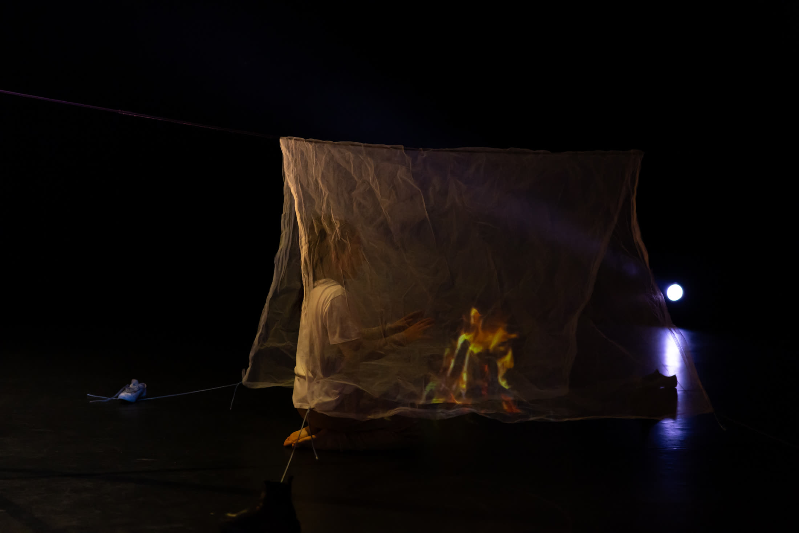
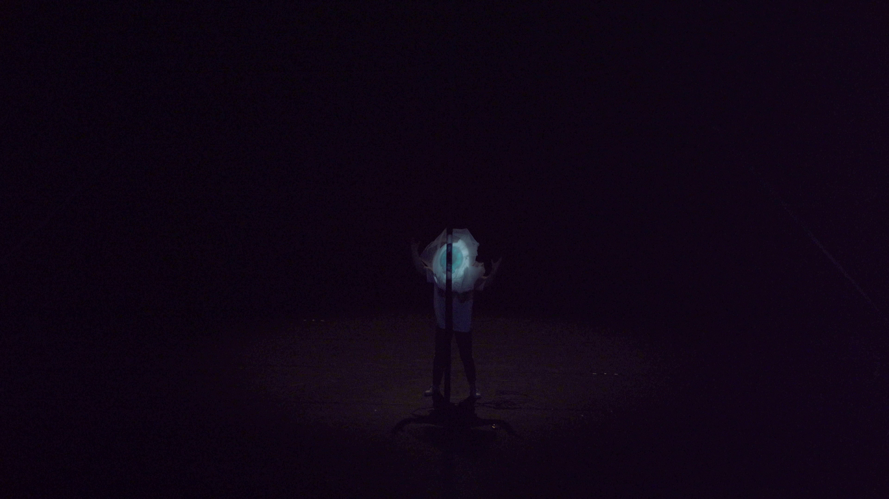
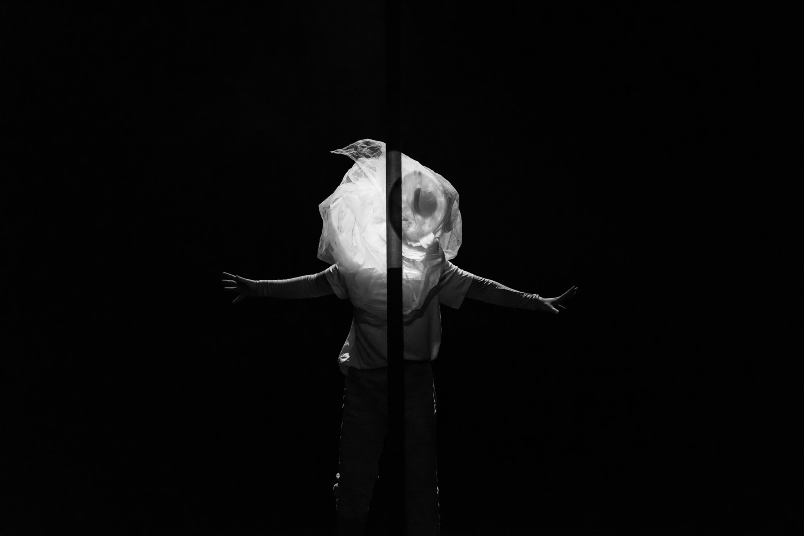
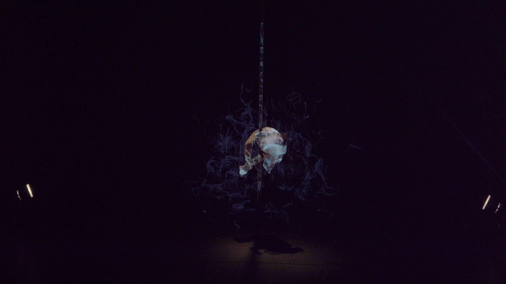
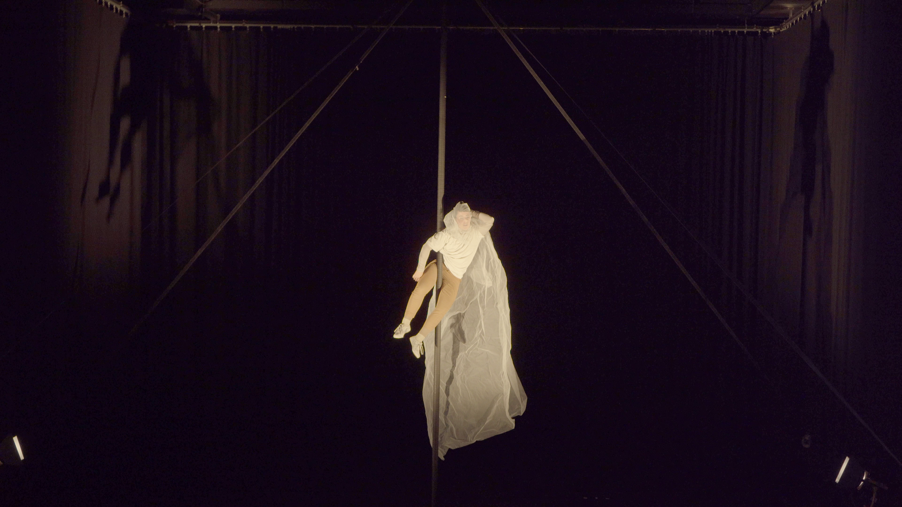
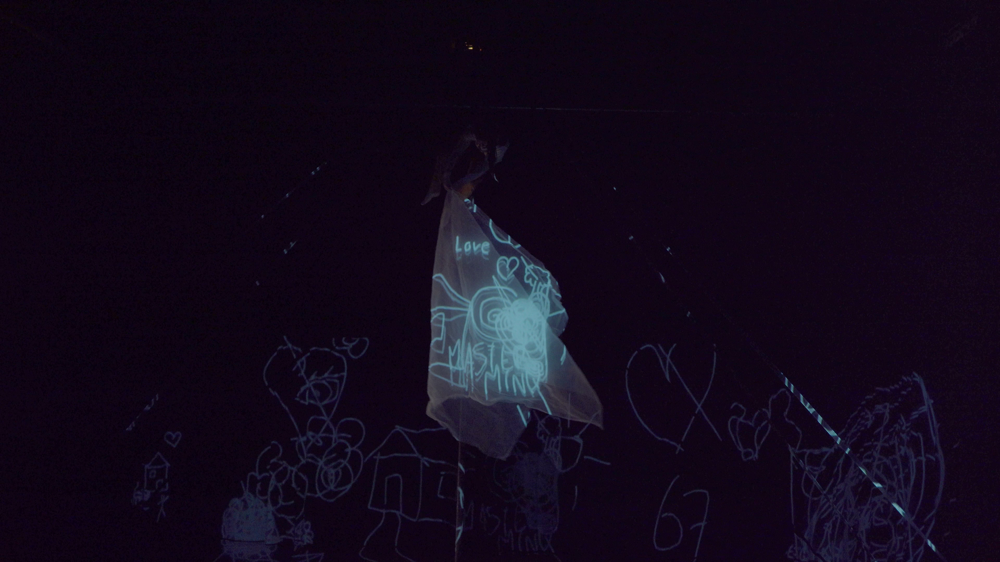
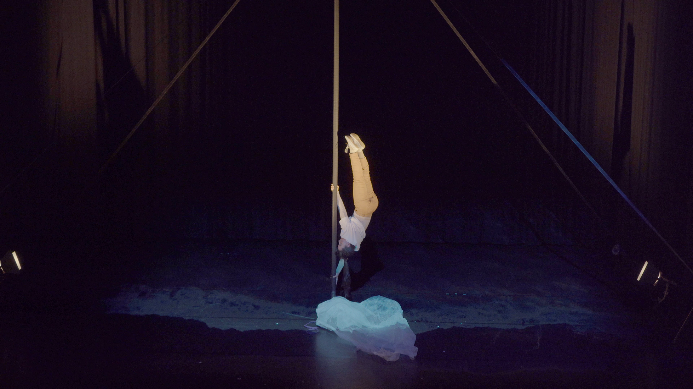
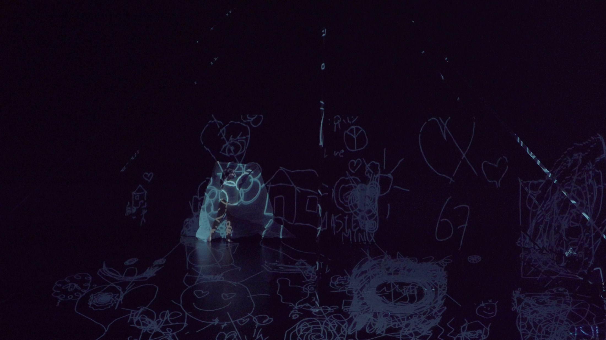
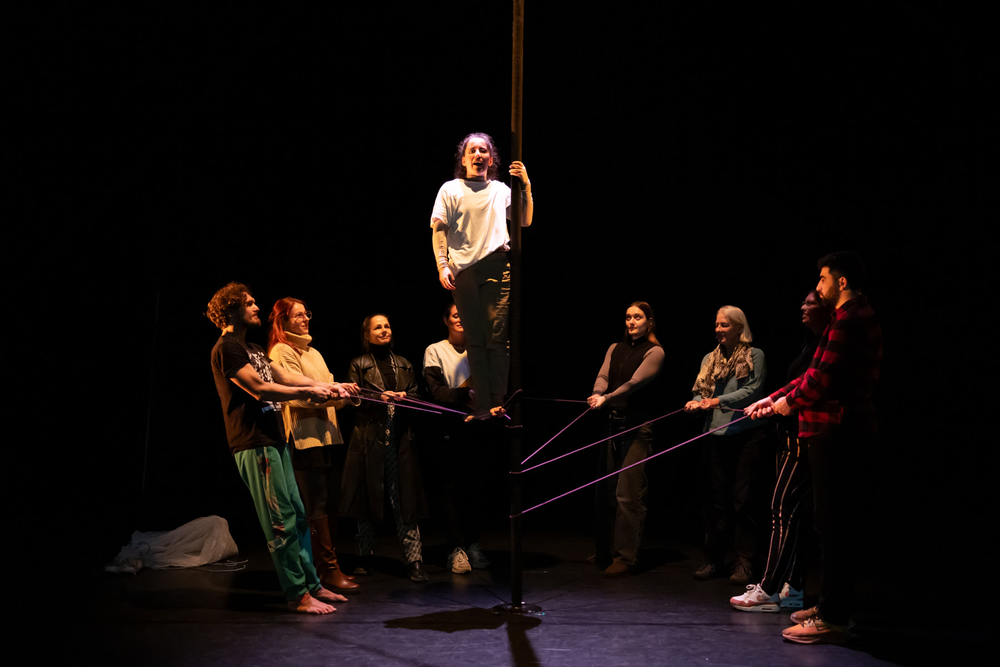
