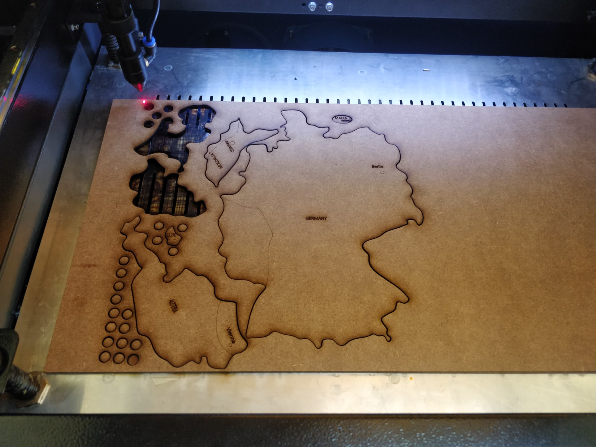
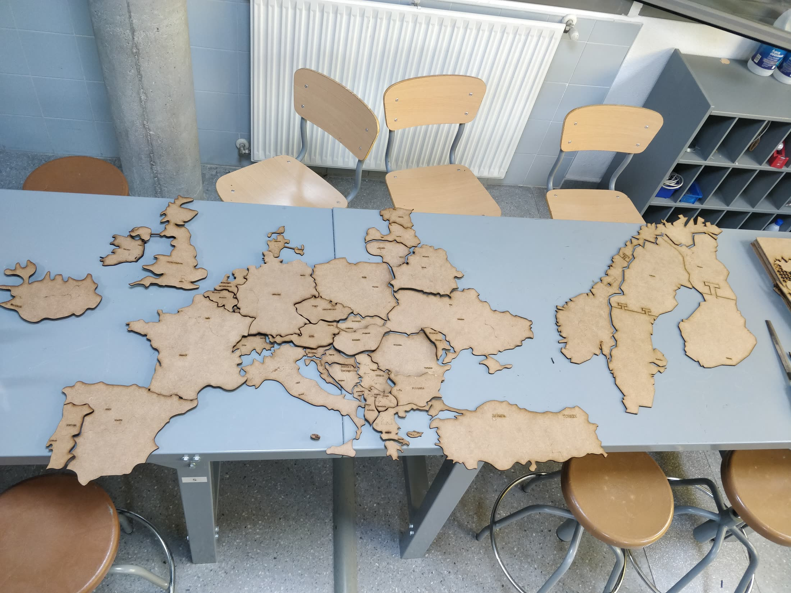
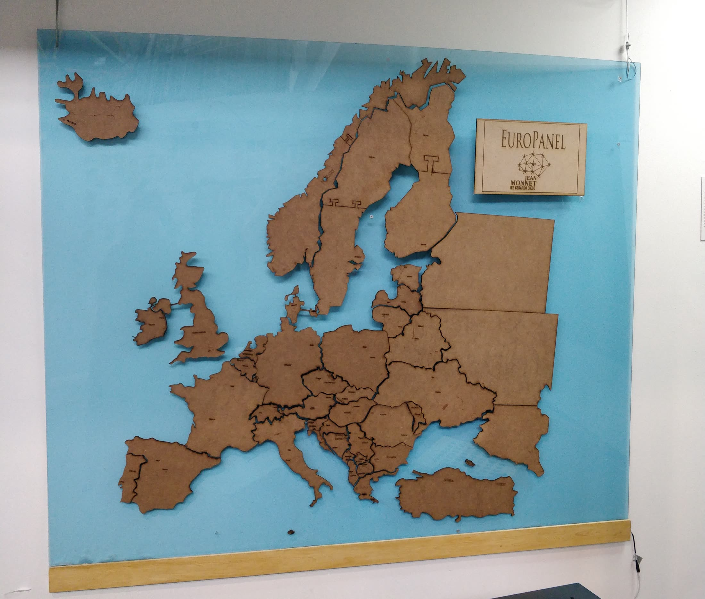

## Descripción
Gracias a la red Planea, fui uno de los artistas que llevó a cabo una actividad con los alumnos del IES Gerardo Diego (Pozuelo de Alarcón) para la elaboración de un mapa de Europa durante la semana de la ciencia. Durante esta semana, los alumnos exploraron temáticas tanto técnicas —edición de imágenes vectoriales, corte láser y técnicas de fabricación— como sociológicas sobre la Unión Europea, la identidad y el colonialismo.

## Características técnicas
- Corte láser
- Fabricación
- Software: Inkscape

## Timeline
- Semana del 23 al 26 de marzo de 2026: presentación, ejecución y ensamblado de la pieza con los alumnos

## Ficha técnica
- Organiza: Red Planea
- Acoge: IES Gerardo Diego
- Dirige: Alfredo Miralles ([@alfredomiralles](https://www.instagram.com/alfredomiralles/)) y David Mingorance ([@david_mingorance](https://www.instagram.com/david_mingorance/))
- Asistencia técnica: Patricia Jiménez Ramos ([@patroclix](https://www.instagram.com/patroclix))

## Galería

