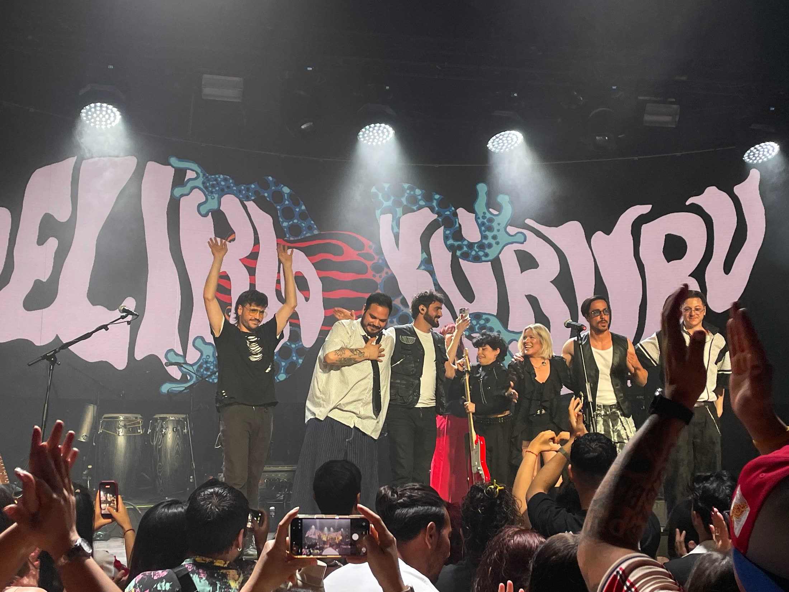
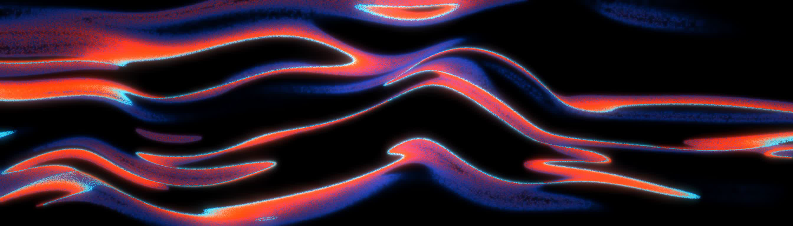
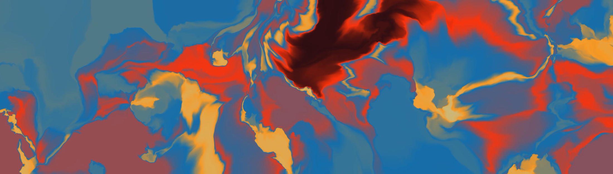
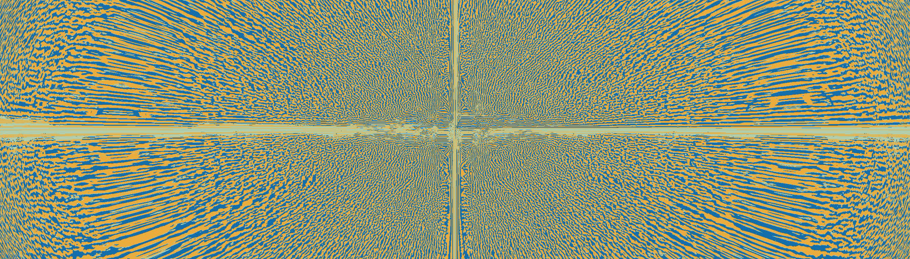

## Descripción
Visuales generados para la banda Delirio Kururú que se presentaba con su nuevo nombre en el acompañamiento a la gira de Kchiporros.
Los visuales reflejan el estilo psicodélico cumbión fiestero que Delirio Kururú transmite en sus conciertos y con sus canciones.

## Características técnicas
- Combinación de dibujo digital con vídeo generativo
- Software: TouchDesigner, After Effects

## Timeline
- 26 de junio de 2026: concierto sala Razzmatazz (Barcelona)
- 28 de junio de 2026: concierto sala Wagon (Madrid)

## Ficha técnica
- Dirección artística: Laco ([@la.cordura](https://www.instagram.com/la.cordura/)) y Marina ([@marinass.art](https://www.instagram.com/marinass.art/))
- Elaboración de dibujos: Marina ([@marinass.art](https://www.instagram.com/marinass.art/))
- Animación y visuales: Joel Beleña, Laco ([@la.cordura](https://www.instagram.com/la.cordura/)) y Muni ([@dasistmirbier](https://www.instagram.com/dasistmirbier/))

## Galería

