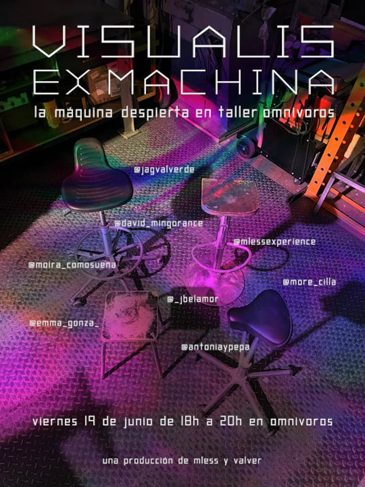

## Descripción
Actuación con parte del colectivo TouchDesigner Madrid para la sesión de Visualis Ex Machina. Para ello, se construyó una interfaz ad-hoc en TouchDesigner que permitiese jugar con la distribución de los vídeos adaptados a la superficie de proyección.
"El proceso es el espectáculo. Los artistas apagan su equipo y a ellos mismos."

## Características técnicas
- Video mapping
- Software: TouchDesigner

## Timeline
- Actuación única: 19 de junio de 2026

## Ficha técnica
- Organiza: Miguel Ángel Ballesta ([@mlessexperience](https://www.instagram.com/mlessexperience/))
- Acoge: Taller Omnívoros
- Colectivo: TouchDesigner Madrid

## Galería

